<h1 align="center">Hi 👋, I'm Kartikey Singh</h1>
<!-- <h3 align="center">Full Stack Developer</h3>

  

 -->

  <picture>
    <source media="(prefers-color-scheme: dark)" srcset="https://raw.githubusercontent.com/kartikbhaii/kartikbhaii/output/pacman-contribution-graph-dark.svg">
    <source media="(prefers-color-scheme: light)" srcset="https://raw.githubusercontent.com/kartikbhaii/kartikbhaii/output/pacman-contribution-graph.svg">
    
  </picture>

<h6 align="center"> Watch these Pac-Man eat my contributions! • • • ⍩⃝ </h6>

<h3 align="center">
  Welcome to my GitHub Universe! I'm a passionate Full Stack Developer from India with a love for building innovative solutions. Whether it's crafting elegant frontends or architecting robust backends, I'm always pushing the boundaries of what's possible with code.
</h3>

   - 🔭 Currently working on HireHub - Job Portal Website 
   - 💻 Passionate about Full Stack Development & DSA 
   - 🚀 Building projects that solve real-world problems 
   - 🌱 Always learning and exploring new technologies 
   - 🎯 Open to collaborating on innovative projects 
   - 📫 Reach me at kkartikeysinghh@gmail.com 
   - ⚡ Fun fact: I believe every bug is just an undiscovered feature! 

 

<h2>📊 GitHub Stats & Trophies</h2>

  
  

  

 

<h2> 🛠️ Languages & Tools </h2>

<h3> 🖥️ Programming & Web Development</h3>

  

<h3>🗄️ Databases & Development Tools</h3>

<h3>💼 Design & Other Tools</h3>

## 🔗 Connect with Me

  &nbsp;&nbsp;&nbsp;&nbsp;&nbsp;&nbsp;
  &nbsp;&nbsp;&nbsp;&nbsp;&nbsp;&nbsp;
  

 

<h3 align="center"> <ins>💭 Dev Quote of the Day</ins></h3>

  

  

